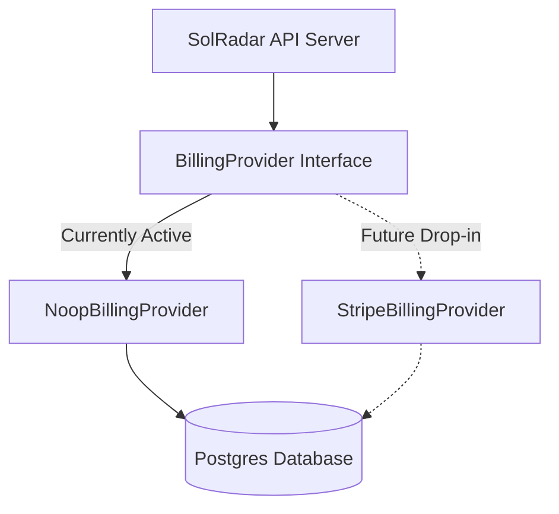

# Stripe Future Migration Plan (`docs/STRIPE_LATER.md`)

> **Directive:** Strict clean-room and zero-cost testing requirement.  
> Currently Active: `NoopBillingProvider` (Zero cost, zero third-party accounts, instant simulated test activations).  
> **Status:** Architecture is 100% pluggable. Swapping to Stripe requires **zero core-logic rewrites**.

---

## 1. Pluggable Architecture Overview

All subscription state machines, plan limits (Scout vs. Hunter), proration math, cancel-at-period-end logic, and referral credit ledgers are fully implemented and verified in `@solradar/shared` and `apps/api`.

The active provider is governed by `BILLING_PROVIDER=noop` in `apps/api/src/config/env.ts` and `apps/api/src/billing/billing.service.ts`.



---

## 2. Steps to Activate Real Stripe

When the team is ready to connect a real Stripe account:

### Step 1: Install the Stripe Node SDK
Run in `apps/api`:
```bash
npm install stripe --save
```

### Step 2: Implement `StripeBillingProvider`
Implement the `BillingProvider` interface (`@solradar/shared/src/billing/index.ts`) in `apps/api/src/billing/stripe.provider.ts`:

```typescript
import Stripe from 'stripe';
import { BillingProvider, PlanCode, CheckoutSessionResult, PortalSessionResult, WebhookProcessingResult } from '@solradar/shared';

export class StripeBillingProvider implements BillingProvider {
  public readonly providerName = 'stripe';
  private stripe: Stripe;

  constructor(apiKey: string) {
    this.stripe = new Stripe(apiKey, { apiVersion: '2023-10-16' });
  }

  async createCheckoutSession(userId: string, planCode: PlanCode, options?: { successUrl?: string; cancelUrl?: string }): Promise<CheckoutSessionResult> {
    const session = await this.stripe.checkout.sessions.create({
      mode: 'subscription',
      payment_method_types: ['card'],
      client_reference_id: userId,
      line_items: [{ price: getPriceIdForPlan(planCode), quantity: 1 }],
      success_url: options?.successUrl || 'https://solradar.io/billing?status=success',
      cancel_url: options?.cancelUrl || 'https://solradar.io/billing?status=cancelled',
    });
    return { checkoutUrl: session.url!, sessionId: session.id, isTestMode: !session.livemode };
  }

  async createPortalSession(userId: string, customerId?: string, returnUrl?: string): Promise<PortalSessionResult> {
    const portal = await this.stripe.billingPortal.sessions.create({
      customer: customerId!,
      return_url: returnUrl || 'https://solradar.io/billing',
    });
    return { portalUrl: portal.url, isTestMode: false };
  }

  async handleWebhook(payload: any, signature?: string): Promise<WebhookProcessingResult> {
    const event = this.stripe.webhooks.constructEvent(payload, signature!, process.env.STRIPE_WEBHOOK_SECRET!);
    // Map event.data.object to standard WebhookProcessingResult
    // ...
  }

  async cancelSubscription(subscriptionId: string, immediate = false) {
    if (immediate) {
      await this.stripe.subscriptions.cancel(subscriptionId);
    } else {
      await this.stripe.subscriptions.update(subscriptionId, { cancel_at_period_end: true });
    }
    return { success: true, cancelAtPeriodEnd: !immediate };
  }

  async getSubscriptionStatus(subscriptionId: string) {
    const sub = await this.stripe.subscriptions.retrieve(subscriptionId);
    return {
      status: sub.status,
      currentPeriodEnd: new Date(sub.current_period_end * 1000),
      planCode: getPlanCodeFromPriceId(sub.items.data[0].price.id),
      cancelAtPeriodEnd: sub.cancel_at_period_end,
    };
  }
}
```

### Step 3: Configure Environment Variables
Update `.env` in production:
```env
BILLING_PROVIDER=stripe
STRIPE_SECRET_KEY=sk_live_...
STRIPE_WEBHOOK_SECRET=whsec_...
STRIPE_SCOUT_PRICE_ID=price_...
STRIPE_HUNTER_PRICE_ID=price_...
```

### Step 4: Webhook Endpoint
The endpoint is already live and routed at:
`POST /billing/webhook`

In Stripe Dashboard:
- Add webhook endpoint: `https://api.solradar.io/billing/webhook`
- Listen for events:
  - `checkout.session.completed`
  - `customer.subscription.created`
  - `customer.subscription.updated`
  - `customer.subscription.deleted`
  - `invoice.payment_succeeded`
  - `invoice.payment_failed`

### Step 5: Verification & Zero-Downtime Swap
1. Run `apps/api/test/billing-idempotency.test.ts`. The idempotency table `payment_events` will automatically deduplicate real Stripe webhook retries via `stripe_event_id`.
2. Existing test subscriptions remain completely unaffected.
